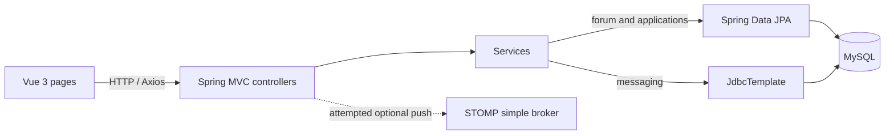
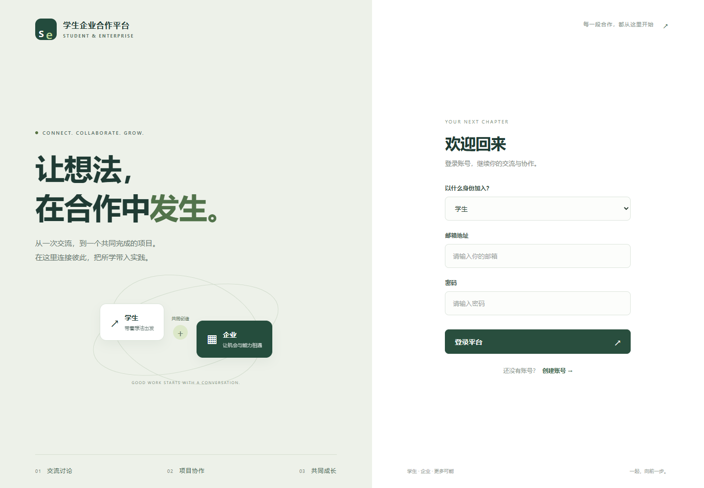
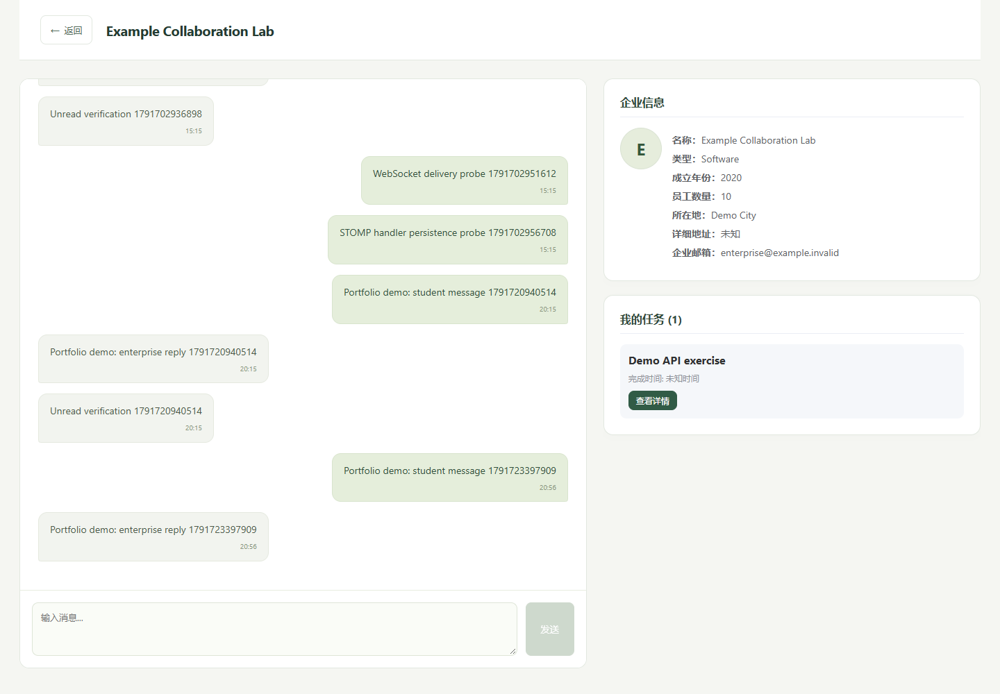
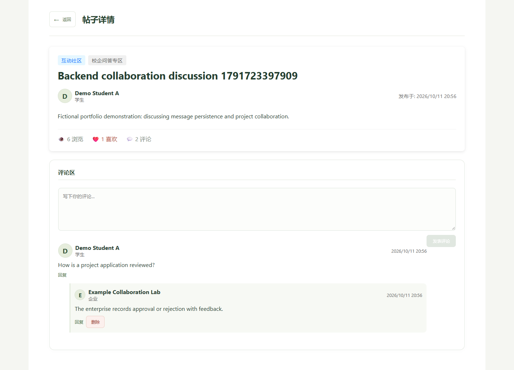
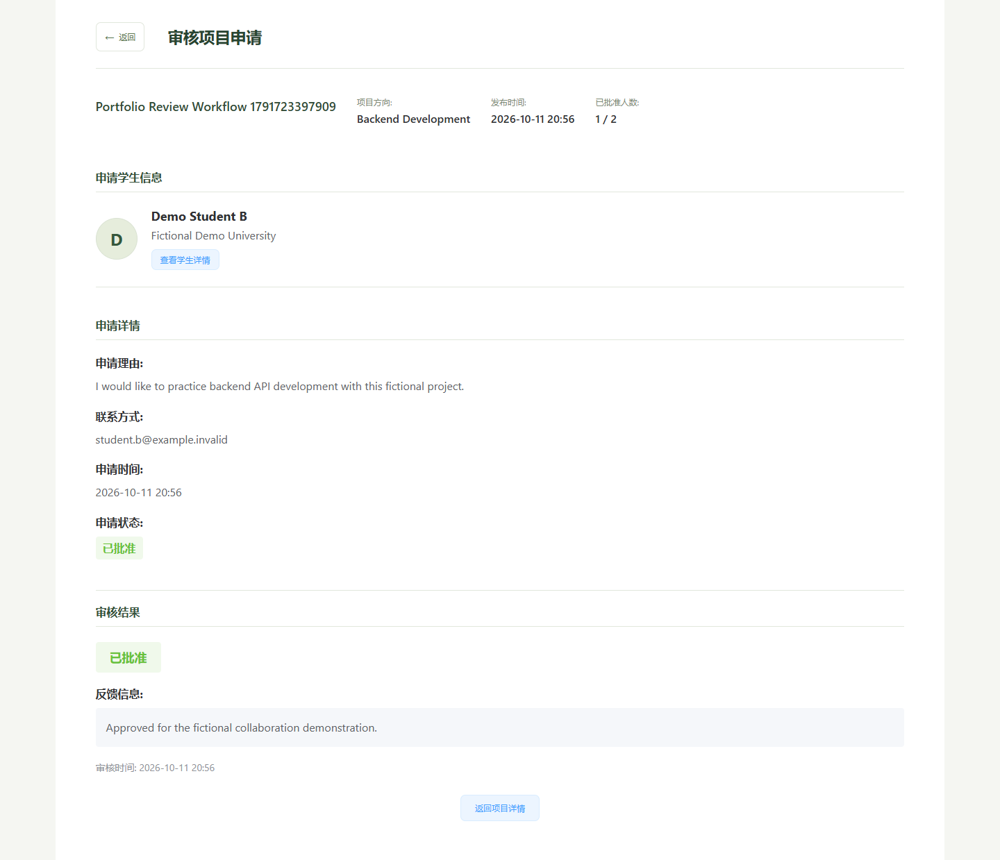

# Student–Enterprise Collaboration Platform

A solo undergraduate final-year project connecting university students and enterprises through one-to-one messaging, a discussion forum, and project applications and reviews.

**Author:** Yiming Luo · **Role:** Sole developer · **Original project:** January–June 2025.
The author independently completed and demonstrated the original project. This repository is a portfolio edition prepared in **October 2026**; its sanitized configuration, synthetic fixtures, documentation, portability fixes, and limited safety changes were added during that preparation, not during the undergraduate project. See [the preparation record](docs/PORTFOLIO-PREPARATION.md).

This is a local educational demonstration, not a production messaging service. It has no claimed user scale, benchmark results, test coverage, or production deployment. The interface is primarily in Chinese.

## What I built

I implemented the Vue frontend, Spring Boot HTTP endpoints and business logic, relational entities and persistence, and the student/enterprise collaboration workflows. The backend areas most relevant to a Social backend role are:

- **Messaging:** HTTP message submission, MySQL persistence, chronological history, unread counts, and read-state updates. The student client polls every three seconds. The enterprise client contains a STOMP/SockJS branch and falls back to polling; its imports are commented out and the current entry page does not supply the required globals.
- **Forum:** paginated posts, category and keyword filtering, post editing and soft deletion, comments and direct replies, likes/unlikes, and liked-post lists.
- **Project collaboration:** project listings, applications, duplicate checks, participant-limit checks, approval/rejection feedback, and resubmission after rejection. Subsequent project-step submission checks whether the application was approved.
- **Other existing modules:** tasks and submissions, enterprise verification, job applications, competitions, events, ratings, and training materials. These remain in the source, but are not all covered by the fixture or runtime verification.

Registration/login and role-specific pages exist. This is **not** a claim of secure authentication or complete RBAC; see the limitations below.

## Architecture and code map



A single Spring Boot backend serves the Vue application through HTTP APIs. Most modules follow Controller → Service → Repository. Login directly uses repositories from `UserController`; chat uses JDBC from `ChatService` rather than the injected JPA chat repository. The `mapper` directory predominantly contains JPA repositories, not MyBatis SQL mappers.

```text
.
├── src/main/java/cn/com/dhc/
│   ├── controller/       HTTP and STOMP handlers
│   ├── service/          Business logic
│   ├── mapper/           Primarily Spring Data JPA repositories
│   ├── repository/       Additional JPA repositories
│   ├── Entity/           JPA entities
│   ├── dto/              Request and response objects
│   └── Config/           Web, uploads, and database configuration
├── src/main/resources/application.properties
├── src/test/             Original minimal Spring context test
├── StudentAndEnterFront/ Vue application, package manifest and lockfile
├── database/             Fresh schema and fictional demo records
├── docs/                 Flow explanations, preparation and validation records
├── docs/screenshots/     Real local browser screenshots and capture notes
├── scripts/              Schema export, content checks, browser verification
├── .env.example          Reference environment values; not auto-loaded
├── .mvn/                 Maven wrapper bootstrap
└── pom.xml
```

## Stack and environment

| Component | Source declaration / locked version | Notes |
| --- | --- | --- |
| Java | Java 8 source/target in `pom.xml` | Preparation environment: Microsoft OpenJDK 17.0.17; original runtime version was not recorded |
| Spring Boot | 2.7.13 | MVC, JPA/Hibernate, JDBC, validation, WebSocket dependencies |
| Maven | Wrapper distribution 3.8.7 | Preparation uses locally available Maven 3.9.11 |
| Database | MySQL | MySQL 8.0.44 verified with a fresh 36-table database |
| Vue / Vue Router | 3.5.13 / 4.5.0 | From the committed npm lockfile |
| Vite | 6.2.0 | Manifest allows `^6.1.0`; locked version shown here |
| Axios / Element Plus | 1.9.0 / 2.9.6 | Locked versions |
| Chart.js | 4.4.9 | Used by the skill radar chart |
| Node / npm | Preparation: Node 24.19.0 / isolated npm 10.9.2 | Original frontend runtime version was not recorded |

MyBatis, Spring Security core, SockJS/webstomp and mail dependencies exist, but their presence is not evidence of a working MyBatis persistence layer, authentication system, end-to-end push delivery, or email verification. Some older Thymeleaf/static pages also remain. No Flyway dependency is configured.

## Local setup

Use a disposable local database and fictional data. The backend binds to `127.0.0.1`; do not expose it to the Internet. The frontend currently calls `http://localhost:8080`, and CORS permits `http://localhost:5173`. Keep those ports and open the browser at **localhost**, not a LAN address.

Prerequisites: a JDK (17 used for preparation), Maven or the included wrapper, Node/npm, and a local MySQL 8 server and client. Builds need Internet access on first use. Do not reuse the original private database or its credentials.

### 1. Create the database

From the repository root, open the MySQL client as a local administrator:

```sh
mysql -u root -p
```

Inside the client:

```sql
SOURCE database/00-create-database.sql;
SOURCE database/01-schema.sql;
SOURCE database/02-demo-data.sql;
```

`01-schema.sql` must be applied to an **empty** database. It is a fresh baseline, not an upgrade migration. `02-demo-data.sql` is optional and is intended to be run once; rerunning it will conflict with its explicit fixture IDs. These files do not delete an existing database.

Create a dedicated local runtime account, choosing your own password (replace the placeholder):

```sql
CREATE USER 'student_enterprise_demo'@'localhost' IDENTIFIED BY '<choose-a-local-password>';
GRANT SELECT, INSERT, UPDATE, DELETE ON student_enterprise_demo.* TO 'student_enterprise_demo'@'localhost';
```

The application uses `ddl-auto=validate`; it does not create/update the schema on startup. Read [database notes](database/README.md) before importing. The schema is derived offline from the current entity mappings and has not been exported from a real database.

### 2. Configure and start the backend

Set `DB_PASSWORD` in the shell that starts Java. `.env.example` is documentation only: Spring Boot does **not** load it automatically.

PowerShell:

```powershell
$env:DB_USERNAME = 'student_enterprise_demo'
$dbCredential = Read-Host 'Local demo database password' -AsSecureString
$env:DB_PASSWORD = [System.Net.NetworkCredential]::new('', $dbCredential).Password
# Optional: set DB_URL or UPLOAD_DIR as described in .env.example.
.\mvnw.cmd -DskipTests package
java -jar target/StudentAndEnter-0.0.1-SNAPSHOT.jar
```

Bash:

```bash
export DB_USERNAME=student_enterprise_demo
read -rs -p 'Local demo database password: ' DB_PASSWORD; echo
export DB_PASSWORD
bash ./mvnw -DskipTests package
java -jar target/StudentAndEnter-0.0.1-SNAPSHOT.jar
```

An installed Maven can replace `mvnw`. The default schema is `student_enterprise_demo`; set `DB_URL` only if using a different local endpoint. Both upload property spellings used by the original source resolve to `UPLOAD_DIR`, defaulting to `./uploads`. Runtime uploads are ignored by Git.

`-DskipTests` skips test execution, not compilation. The original test contains no business assertions and requires a Spring context/database; this command is **not** evidence that functional tests passed.

### 3. Start the frontend in a second terminal

```sh
cd StudentAndEnterFront
npm ci --ignore-scripts
npm run dev -- --host 127.0.0.1 --port 5173 --strictPort
```

Open `http://localhost:5173`. Use `npm run build` for a production asset build. Do not use Vite's default preview port with the existing CORS settings; a local preview can use `npm run preview -- --host 127.0.0.1 --port 5173 --strictPort` after stopping the dev server.

### Fictional demo accounts

All seeded application accounts use the intentionally public, demo-only password **`DemoOnly-2026!`**. This is not a database credential. Never reuse it elsewhere.

| Role selected on login | Email | ID |
| --- | --- | --- |
| Student | student.a@example.invalid | 1001 |
| Student | student.b@example.invalid | 1002 |
| Enterprise | enterprise@example.invalid | 2001 |
| Admin | admin@example.invalid | 9001 |

The seed includes a completed task/contact, an approved fictional enterprise, two messages, one forum post with a reply and like, and a pending project application. Use separate browser profiles for student and enterprise because the original app stores one active identity in `localStorage`.

## Key backend workflows

### Messaging

`Chats2e.vue.sendMessage()` / `Chate2s.vue.sendMessage()` → `POST /api/chat/send` → `ChatController.sendMessageHttp()` → transactional `ChatService.saveMessage()` → parameterized JDBC insert into `chat_message` → saved message DTO.

The receiver calls `GET /api/chat/history/{userId1}/{userId2}` every three seconds in polling mode. JDBC returns the entire two-way history ordered by timestamp; the frontend displays only the last 20 entries. This is not server-side pagination. Read state is updated through `/api/chat/mark-read/{receiverId}/{senderId}`; `/api/chat/unread/{userId}` counts unread rows.

The backend also contains `/ws`, a simple in-memory STOMP broker and a message handler. HTTP sends attempt a user-destination push after saving. The enterprise frontend's WebSocket imports are commented out, and authenticated user-to-WebSocket identity binding is absent. **The browser messaging path is HTTP with polling.** The October 2026 probe confirmed WebSocket/STOMP connection and inbound message persistence, but no recipient push arrived during the five-second observation window. See [the transport report](docs/websocket-validation.json). An enterprise-only local retry queue exists; server-side deduplication does not.

### Forum

Vue forum pages → `/api/forum` → `ForumController` → transactional `ForumService` → JPA repositories → `forum_post`, `forum_comment`, and `forum_like`.

List queries use `Pageable`; search uses title/content `LIKE` queries. Editing/deletion compares supplied author identifiers, post deletion marks `DELETED`, comments reference a post and optional parent, and like toggling inserts/deletes a like row and changes the post's stored count. This supplies useful examples of relational modeling and transactions, but concurrent counter correctness and trusted authorization are not implemented.

### Project applications and reviews

`ProjectApplication.vue` → `POST /api/projects/{projectId}/apply?studentId=...` → `applyForProject()` → project/student lookup, duplicate and capacity checks → `project_application` with `PENDING`.

`ProjectApplicationReview.vue` → `PUT /api/projects/applications/{applicationId}/review?status=...` → `reviewApplication()` → capacity check for approval, then persisted status, feedback and review time. A rejected application can be resubmitted using the same row. Approved participation is checked by later project-step submission logic. Transaction annotations do not by themselves prevent concurrent over-approval.

See [flow details and interview discussion points](docs/BACKEND-FLOWS.md).

## Screenshots and demonstration

The portfolio copy was started against an independent MySQL 8.0.44 instance and tested in real Microsoft Edge browser contexts on 11 October 2026. Nine grouped browser/API checks passed; this is scoped verification, not a coverage percentage or a production-readiness claim. The original 2025 demonstration and this 2026 verification are separate events.

| Verification | Result |
| --- | --- |
| Fresh SQL initialization and Hibernate validation | Passed; 36 tables |
| Login, two-way polling chat, history and unread updates | Passed |
| Forum post/comment/reply and sequential like/unlike | Passed; counter race remains |
| Application submission → rejection → resubmission → approval | Passed |
| Fictional file upload/download through API | Passed |
| WebSocket/STOMP connection and inbound persistence | Passed |
| WebSocket recipient delivery without polling | **Not delivered in the probe** |

The interface was refreshed during October 2026 portfolio preparation, with responsive layouts and a shared visual theme. See [UI refresh and checks](docs/UI-REFRESH.md).

Actual screenshots, captured using fictional records:







See [exact results and remaining limits](docs/VALIDATION.md), [screenshot provenance](docs/screenshots/README.md), and [repeatable browser checks](scripts/e2e/README.md).

## Known limitations

- Password checking remains plaintext; there is no complete session/token authentication or server-side RBAC. Browser IDs and role strings are not trusted authorization. Portfolio cleanup suppresses password serialization and an admin password log, but does not turn this into a secure production application.
- Student and enterprise IDs come from separate tables, while chat queries identify participants only by ID. Collisions can mix histories/read counts, and equal IDs can be treated as a self-message. The fixture uses distinct ID ranges to avoid the issue during a small demo; the underlying bug remains.
- Histories are loaded in full. Student unread totals are derived from completed-task contacts, while the enterprise also uses a direct unread endpoint; they do not have identical coverage.
- WebSocket recipient delivery failed the isolated probe despite successful connection and persistence. Authenticated subscription binding, delivery acknowledgements, retry deduplication, multi-device synchronization and multi-instance routing remain incomplete/unverified.
- Application review accepts loosely validated status strings and does not verify the reviewing enterprise's ownership. Capacity check/update can race. Resubmission overwrites previous review information.
- Like/view counts use read-modify-write updates without concurrency control. Per-post DTO mapping adds queries. Comment expansion returns only direct children; parent-post consistency and soft-deleted detail filtering are incomplete.
- Student verification checks a nonempty supplied code rather than an external education service. Training video playback has a placeholder. Do not treat all visible pages as complete integrations.
- Original database repair scripts were not a reliable migration chain and are excluded. Developer database endpoints and the global packet-size mutation are disabled unless the explicitly named `legacy-maintenance` profile is activated. Do not activate it for the public demo.
- The original JUnit test has no business assertions and was not executed. New October 2026 browser/API scripts cover selected local workflows only. No comprehensive regression suite, performance benchmark or dependency vulnerability audit was performed.

## Validation and publication scope

See [docs/VALIDATION.md](docs/VALIDATION.md) for exact commands, results and unverified steps, and [docs/PUBLICATION-AUDIT.md](docs/PUBLICATION-AUDIT.md) for the content audit. Build output, dependencies, logs, uploads and real credentials are excluded by `.gitignore`.

This portfolio edition has its own Git history; the original project history is excluded. Only the source repository is intended for publication. Local database credentials, runtime data and validation caches remain outside it.
